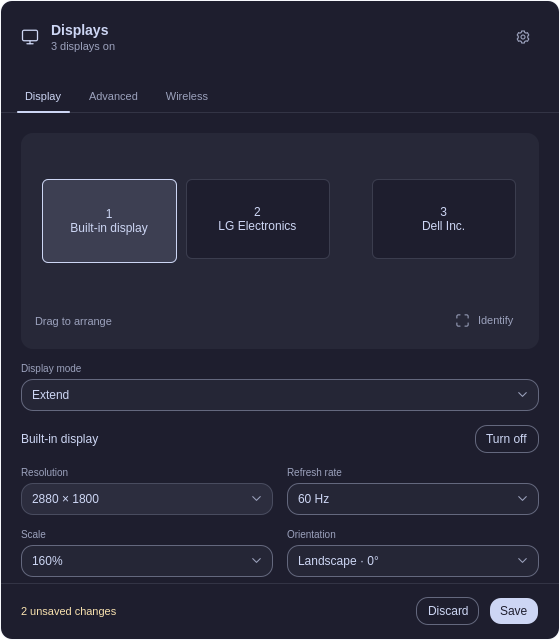

# Foamy Monitor

Display arrangement, safe display trials, brightness, scaling and wireless
casting for the Omarchy bar.



## Install

```sh
omarchy plugin add https://github.com/foamrider/foamy-monitor.git --enable
```

Built for Omarchy 4.5; it also loads on Omarchy 4.0 (English only there). It
replaces the stock Display widget (`omarchy.monitor`), so use one display
plugin at a time and disable any older local replacement.

Requires Hyprland, Python 3, `gsettings` (cursor size) and Omarchy's
`omarchy-brightness-display` and `omarchy-display-text-size`. Brightness on
external displays goes through Omarchy's DDC helper (`ddcutil`).

Optional, for wireless casting: FluxCast (`fluxcast-git`) and FFmpeg
(`ffmpeg`).

## Use

- Left-click the widget to open the panel. Scroll on it to change the
  brightness of the display that bar is on; Omarchy's on-screen display shows
  the new level.
- **Display**: select a display in the diagram (or in the list below it for
  displays that are off, mirrored or disconnected), drag it into position, and
  set display mode, resolution, refresh rate, scale, orientation and
  brightness. **Identify** shows each display's name on it.
- **Advanced**: text size, cursor size and GTK scale.
- **Wireless**: find a receiver and cast the selected display. The search runs
  while the tab is open and stops when the panel closes; the Scan icon turns
  while it runs. Receivers it found are remembered for two minutes: reopening
  the panel shows them at once and refreshes the list in the background
  (receivers that are gone drop out when the refresh finishes). An older list
  is dropped and a new search starts.
- There are no plugin settings: the language follows Omarchy → Setup →
  Language.

**Save** starts a 15-second trial. Choose **Keep settings** to write
`~/.config/hypr/monitors.lua`, or **Revert** (or Esc) to restore the previous
configuration. The trial also reverts when it times out or a display is
unplugged. Brightness, text size and cursor size apply immediately.

### Keyboard

One cursor, shared with the pointer: arrows or `j`/`k` move it, `h`/`l` switch
tabs and step the brightness, Enter activates (and opens a dropdown), `m` on a
display in the diagram moves it with the arrow keys (10 px per press; Enter or
Esc to drop), `w` opens Wireless, `r` refreshes, Ctrl+S saves.
Tab and Shift+Tab move to the next bar panel. Esc reverts a running trial,
otherwise closes the panel.

### IPC

`omarchy-shell foamy.monitor <command>` (4.5) or `qs ipc call foamy.monitor
<command>`: `open`, `close`, `toggle`, `scanWireless`,
`stopWireless`, `status` (JSON), and `brightness <percent>` for the focused
display (`40`, `+5` or `-5`; it answers with an error when the display has no
brightness control).

## How it works

- One copy of the display state, brightness queue and FluxCast processes
  serves every bar (Omarchy 4.5 draws one bar per monitor).
- Nothing polls while the panel is closed. The display helper runs once at
  start, when another panel or the trial worker changes its state file, and
  on Hyprland output events (display added or removed, config reloaded). It
  refreshes every 5 seconds while a panel is open and every second during a
  trial.
- Brightness is read only for an open panel, the scroll wheel or IPC, and one
  `omarchy-brightness-display` call runs at a time, so DDC reads and writes
  never overlap on a bus.
- The wireless search runs only while an open panel shows the Wireless tab,
  one search at a time for every bar.
- FluxCast stops when the plugin is disabled or removed, when the shell
  reloads, and when its helper is killed (it runs with a parent-death signal).

### monitors.lua

Saving rewrites only literal `hl.monitor({ … })` rules (it refuses
conditional or computed configuration) and adds a rule for a display that has
none. External displays are saved by EDID description (`desc:…`), so they
keep their settings on another port. Built-in panels (`eDP`, `LVDS`, `DSI`)
are saved by connector name, which is what Omarchy's clamshell handling reads
to restore their scale and position. A display whose scale you did not change
keeps `scale = omarchy_monitor_scale`, so `omarchy hyprland monitor scaling`
and the stock scale buttons still reach it; a scale you pick in this panel is
saved as a number for that display.

Saving GTK scale updates `GDK_SCALE` in the Hyprland and D-Bus/systemd user
environments. The plugin uses `systemctl --user show-environment` to preserve
the previous value and `systemctl --user unset-environment GDK_SCALE` when a
rollback must restore an unset value. These operations affect the user session;
they do not manage system services or require administrator privileges.

## Language

Language follows **Omarchy → Setup → Language** on Omarchy 4.5 (English and
Norwegian catalogs; other languages fall back to English, and right-to-left
languages mirror the panel). Omarchy 4.0 shows the plugin in English.

## Remove

Finish or revert any active display trial first.

```sh
omarchy plugin remove foamy.monitor
```

Removing or disabling the plugin stops a running cast. When removing an
enabled replacement, Omarchy restores `omarchy.monitor`. Saved display
layouts, brightness, font size, cursor size and GTK scale remain as last
configured; removal does not roll them back. FluxCast and FFmpeg remain
installed.

## Development

`kit/` holds shared components copied from [foamy-kit](https://github.com/foamrider/foamy-kit); edit them there, not here.

```sh
node tests/model.test.js && node tests/i18n.test.cjs
python3 -I tests/test_display_transaction.py && python3 -I tests/test_fluxcast_bridge.py
python3 tests/runtime.py            # offscreen, 4.0 and 4.5 hosts (needs foamy-kit)
python3 tests/runtime-idle.py       # processes and CPU while every popup is closed
bash tests/kit-check.sh
```

The runtime tests use the foamy-kit harness (`FOAMY_KIT`, default
`~/GitHub/Personal/foamy-kit`) with fake `hyprctl`, brightness and FluxCast
commands; nothing reaches the live session or the displays.

## License

Licensed under [MIT](LICENSE), with [Monitor Settings Extender](LICENSE-MONITOR-SETTINGS-EXTENDER),
[Omarchy](LICENSE-OMARCHY), and [Lucide](LICENSE-LUCIDE) notices.

Provided **as is**, without warranty or guaranteed support. Use at your own risk.
